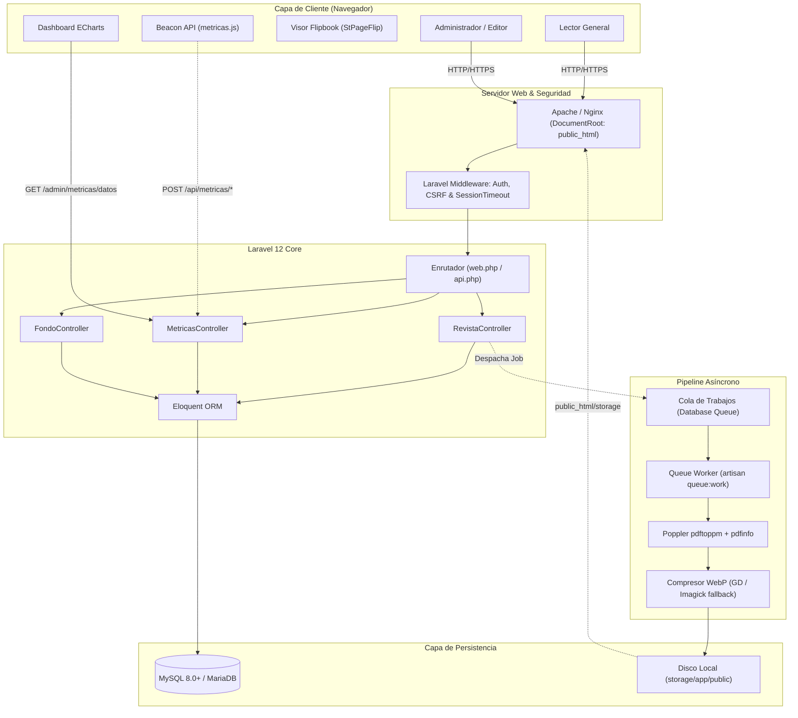
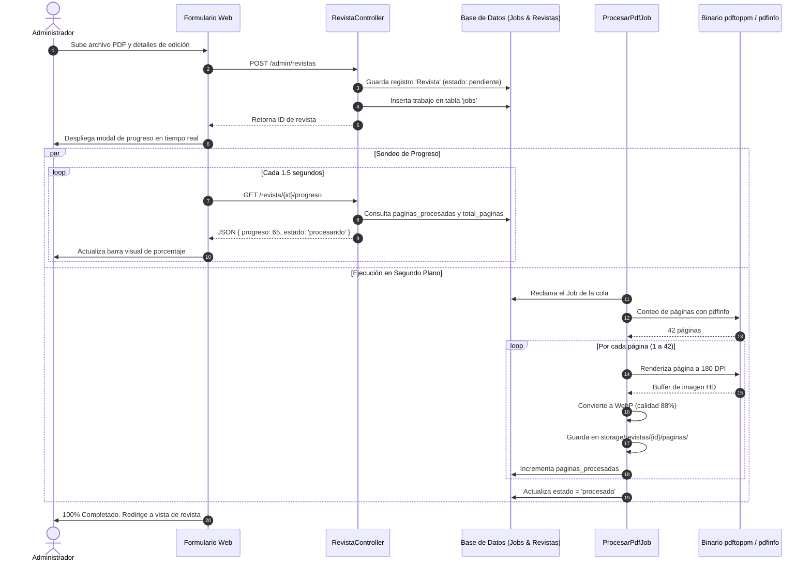
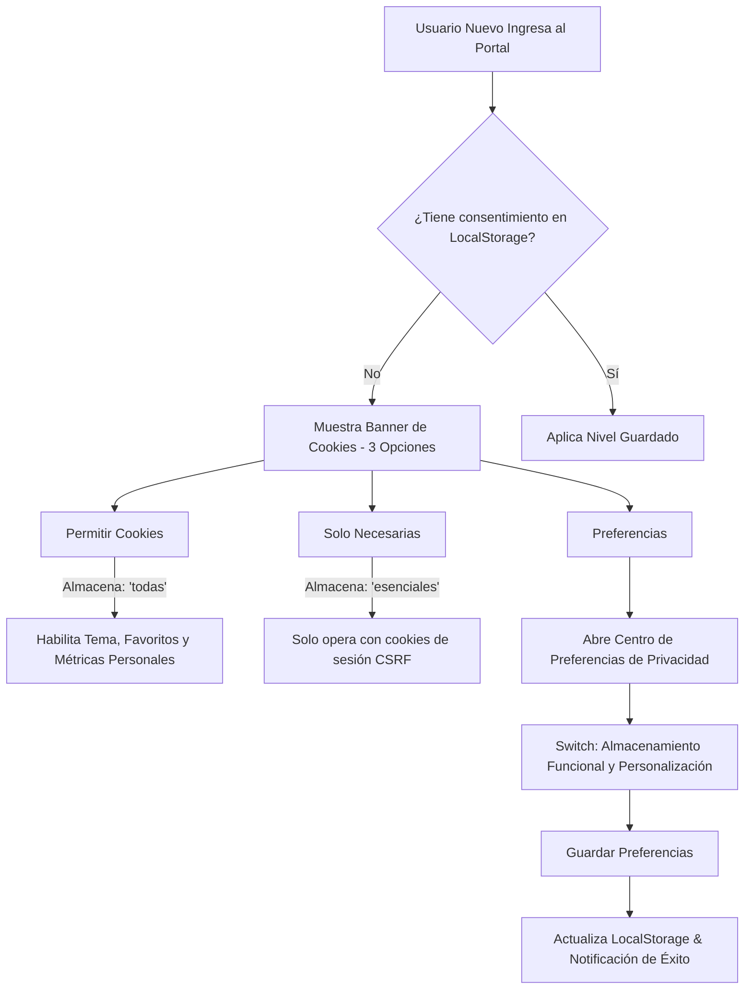

# 📘 MANUAL TÉCNICO Y ARQUITECTURA DE ITINEWS v2.0
> **Universidad Politécnica del Valle de Toluca (UPVT)**  
> *División de Ingeniería en Tecnologías de la Información*  
> **Documento Técnico de Referencia y Registro de Cambios Mayores (v2.0)**

---

## 📑 Índice General
1. [Resumen Ejecutivo de la Versión 2.0](#1-resumen-ejecutivo-de-la-versión-20)
2. [Comparativa: Versión Anterior vs. Versión 2.0](#2-comparativa-versión-anterior-vs-versión-20)
3. [Arquitectura General del Sistema](#3-arquitectura-general-del-sistema)
4. [Módulo 1: Pipeline de Procesamiento de Revistas (PDF a WebP Ultra HD)](#4-módulo-1-pipeline-de-procesamiento-de-revistas)
5. [Módulo 2: Motor de Telemetría y Métricas Administrativas](#5-módulo-2-motor-de-telemetría-y-métricas-administrativas)
6. [Módulo 3: Sistema de Fondos Estacionales y Dinámicos](#6-módulo-3-sistema-de-fondos-estacionales-y-dinámicos)
7. [Módulo 4: Portal Público, Visor Flipbook y Estadísticas Locales](#7-módulo-4-portal-público-visor-flipbook-y-estadísticas-locales)
8. [Módulo 5: Privacidad, RGPD y Centro de Preferencias](#8-módulo-5-privacidad-rgpd-y-centro-de-preferencias)
9. [Módulo 6: Rediseño del Panel de Administración y Login](#9-módulo-6-rediseño-del-panel-de-administración-y-login)
10. [Guía de Replicación e Instalación en Servidores](#10-guía-de-replicación-e-instalación-en-servidores)
11. [Mantenimiento Operativo y Comandos Artisan](#11-mantenimiento-operativo-y-comandos-artisan)
12. [Límites del Sistema y Condiciones de Borde](#12-límites-del-sistema-y-condiciones-de-borde)
13. [Escalabilidad y Hoja de Ruta para Nuevas Funcionalidades](#13-escalabilidad-y-hoja-de-ruta-para-nuevas-funcionalidades)

---

## 1. Resumen Ejecutivo de la Versión 2.0

La versión 2.0 de **ITINEWS** representa una reingeniería completa de la experiencia de usuario, el rendimiento editorial y la observabilidad institucional. El portal ya no es un simple repositorio de archivos PDF estáticos; ahora es una **plataforma editorial digital de alto rendimiento** que procesa documentos PDF en segundo plano para generar experiencias interactivas tipo libro (*flipbook*), optimizadas para Ultra Alta Definición mediante compresión de última generación **WebP**.

Adicionalmente, incorpora un **sistema de analíticas anónimo y privado**, un **panel administrativo unificado con Apache ECharts**, **fondos dinámicos estacionales** y un estricto **cumplimiento normativo de privacidad** con centro de preferencias.

---

## 2. Comparativa: Versión Anterior vs. Versión 2.0

| Dimensión | Versión Anterior (v1.x) | Versión Actual (v2.0) |
|---|---|---|
| **Formato de Entrega** | PDFs embebidos o JPGs pesados a baja resolución (~72 DPI). | Imágenes **WebP Ultra HD a 180 DPI** (~2400px de ancho) con ahorro de 65-75% de ancho de banda. |
| **Tiempo de Conversión** | Síncrono mediante Imagick/Ghostscript (bloqueaba el servidor 2-5 minutos). | **Asíncrono con Poppler (`pdftoppm` + `pdfinfo`)** en colas de Laravel (~15-30 seg por revista de 40 págs). |
| **Monitoreo de Carga** | La pantalla se congelaba sin feedback al usuario. | **Modal reactivo en tiempo real con barra porcentual**, conteo de páginas y estados paso a paso. |
| **Panel de Métricas** | Inexistente o limitado a un contador básico en BD. | **Dashboard integral con Apache ECharts**: treemap de categorías, barras de dispositivos, líneas temporales y KPIs. |
| **Privacidad de Métricas** | No había recolección estructurada. | **Telemetría no invasiva**: Beacon API, fingerprint hash SHA-256 (sin IP ni datos personales expuestos). |
| **Ambientación Visual** | Fondo fijo estático en portada. | **Sistema de Fondos Estacionales y Fechas Conmemorativas**: presets programables, carrusel con transiciones suaves. |
| **Visor Flipbook** | Básico, con márgenes negros y zoom deficiente. | **Full Viewport (`100vw × 100vh`)**, zoom de doble página con arrastre (*pan & drag*), modo oscuro y soporte táctil. |
| **Estadísticas del Lector** | Inexistentes para el estudiante. | **"Mis Estadísticas" privadas en LocalStorage**: tiempo dedicado, páginas leídas, favoritos y modal propio de reinicio. |
| **Privacidad / Cookies** | Sin banner ni control para el usuario. | **Banner interactivo de 3 estados + Centro de Preferencias** (gestión de esenciales y funcionales). |
| **Panel de Administración** | Vistas dispersas con botones desbordados y diseño rígido. | **Diseño moderno unificado**: tarjetas con rejilla auto-ajustable, vista de tabla compacta, búsqueda en vivo y botones contenidos. |

---

## 3. Arquitectura General del Sistema

El sistema implementa una arquitectura desacoplada basada en el patrón MVC de Laravel 12, con un motor de colas para procesamiento pesado en segundo plano y una capa de presentación interactiva con JavaScript ES6 nativo.



---

## 4. Módulo 1: Pipeline de Procesamiento de Revistas

### 4.1. El Reto Tecnológico
Anteriormente, subir un PDF de 50 MB con 40 páginas a color causaba *timeouts* de PHP (`max_execution_time`) o sobrecargas de memoria en `Imagick`.

### 4.2. Solución Implementada: Poppler + WebP + Colas
1. **Detección Rápida de Páginas**: El worker ejecuta `pdfinfo` mediante CLI. Si no está disponible, utiliza un escaneo binario del archivo buscando marcadores `/Count`. Esto tarda menos de 50 milisegundos.
2. **Extracción Paralela por Lotes**: Utiliza `pdftoppm -png -r 180` o `-jpeg -r 180`. Poppler compila directamente en lenguaje C nativo, renderizando páginas a 180 DPI (~2400px de altura) en un promedio de **0.3 segundos por página**.
3. **Conversión a WebP HD**: Cada imagen se procesa con `imagewebp()` con factor de calidad entre 85 y 90. Esto reduce un archivo de 2.5 MB (JPG) a escasos **350–500 KB (WebP)** manteniendo una nitidez perfecta para texto académico.
4. **Almacenamiento y Portada**: Se genera automáticamente la miniatura de portada (`portada.webp`) y las páginas individuales (`1.webp`, `2.webp`, etc.) dentro de `storage/app/public/revistas/{id}/`.
5. **Progreso en Vivo**: Durante la ejecución, el worker actualiza los campos `paginas_procesadas`, `total_paginas` y `estado` en la base de datos. El cliente realiza un sondeo ligero cada 1.5s a `/revista/{id}/progreso`.



---

## 5. Módulo 2: Motor de Telemetría y Métricas Administrativas

### 5.1. ¿Cómo se capturan las métricas?
El archivo [metricas.js](file:///c:/laragon/www/_itinews-upvt.com.mx/public_html/js/metricas.js) corre de forma silenciosa y asíncrona tanto en el portal como en el visor:

1. **Identificador Anónimo (`visitor_token`)**: Se genera un UUID v4 criptográfico guardado en `localStorage` (con respaldo en cookie `SameSite=Lax`). **No se recolecta nombre, correo ni datos personales del lector**.
2. **Envío no bloqueante con Beacon API**: Utiliza `navigator.sendBeacon()` y `fetch()` con bandera `keepalive: true`. Cuando el usuario cierra la pestaña o cambia de página rápidamente, los eventos garantizan su entrega al servidor sin retrasar la navegación.
3. **Eventos monitorizados**:
   - `portal`: Apertura de la página principal.
   - `revista`: Apertura de una revista específica con su ID.
   - `pagina`: Cambio de página en el flipbook (registra página leída y calcula permanencia).
   - `ping`: Latido cada 30 segundos de lectura activa para calcular tiempo real de atención.
   - `cierre`: Evento de finalización de lectura para calcular el porcentaje de completitud.

### 5.2. Anonimización en el Servidor
Al recibir la petición en `MetricasController`:
- La dirección IP y el `User-Agent` se transforman en un hash irreversible:
  ```php
  $hash = hash('sha256', $request->ip() . $request->userAgent() . config('app.key'));
  ```
- Se analiza el User-Agent para clasificar de forma limpia el **Dispositivo** (Móvil, Tablet, Escritorio), el **Sistema Operativo** (Windows, Android, iOS, macOS, Linux) y el **Navegador** (Chrome, Firefox, Safari, Edge).

### 5.3. Visualización en el Panel de Administración
El panel de administración en [metricas-admin.js](file:///c:/laragon/www/_itinews-upvt.com.mx/public_html/js/metricas-admin.js) consume el endpoint `/admin/metricas/datos?dias=30` y renderiza con **Apache ECharts 5**:
- **Tarjetas KPI**: Visitas totales a revistas, aperturas de portal, lectores únicos, visitantes recurrentes, tiempo promedio de lectura, páginas leídas por sesión y tasa de finalización.
- **Gráfica de Tendencia Temporal**: Líneas suaves con relleno en degradado institucional que muestran visitas totales vs. visitantes únicos por día.
- **Gráfica de Revistas Más Leídas**: Barras horizontales ordenadas por popularidad.
- **Distribución de Dispositivos**: Gráfico tipo Dona (*Donut Chart*) con porcentajes de móvil vs. escritorio.
- **Treemap / Barras de Páginas Más Leídas**: Mapeo de qué páginas específicas concentran la mayor atención de los lectores.
- **Navegadores y Sistemas Operativos**: Gráficos de barras comparativas.

---

## 6. Módulo 3: Sistema de Fondos Estacionales y Dinámicos

Permite al personal administrativo vestir la portada del portal institucional de acuerdo a la época del año o efemérides universitarias y tecnológicas.

```mermaid
flowchart LR
    A[Panel Admin: Fondos] -->|Crear o Seleccionar Preset| B[(Tabla 'fondos')]
    B --> C{Estado del Fondo}
    C -->|Activo = 1| D[Filtro por Fechas: desde / hasta]
    C -->|Activo = 0| E[Ignorado]
    D -->|Fecha Actual coincide| F[Colección de Fondos Vigentes]
    D -->|Sin fechas definidas| F
    F --> G[Carrusel del Portal (carrusel-fondos.js)]
    G --> H[Rotación cada 5s con cross-fade suave]
```

### 6.1. Características del Motor de Fondos
- **Presets Estacionales**: Primavera, Verano, Otoño, Invierno, Día del Programador, Aniversario UPVT, etc.
- **Programación Temporal**: Campos `activo_desde` y `activo_hasta` para que una temática se active y desactive automáticamente sin intervención manual.
- **Transición Fluida en Carrusel**: Si hay múltiples fondos activos en la misma fecha, [carrusel-fondos.js](file:///c:/laragon/www/_itinews-upvt.com.mx/public_html/js/carrusel-fondos.js) los cicla automáticamente cada 5 segundos mediante un efecto *cross-fade* con indicadores tipo puntos (*dots*).

---

## 7. Módulo 4: Portal Público, Visor Flipbook y Estadísticas Locales

### 7.1. Visor Flipbook HD (`flipbook-viewer.js` + `StPageFlip`)
- **Modo Pantalla Completa**: Ocupa el 100% de la ventana (`100vw × 100vh`) sin márgenes negros residuales.
- **Zoom Interactivo de Doble Página**: Permite hacer zoom sobre la doble página abierta y arrastrar con el cursor o el dedo (*pan & drag*) sin romper el layout del visor.
- **Físicas de Hoja Real**: Efecto de página tridimensional con sombras dinámicas al pasar las hojas.
- **Barra de Progreso y Miniaturas**: Tira inferior de miniaturas para saltar directamente a cualquier página de la revista.

### 7.2. "Mis Estadísticas" (Lectura Privada en el Navegador)
- Se implementó un motor local en [flipbook-manager.js](file:///c:/laragon/www/_itinews-upvt.com.mx/public_html/js/flipbook-manager.js) que calcula en tiempo real:
  - Tiempo total invertido leyendo publicaciones.
  - Total de páginas leídas acumuladas.
  - Lista de publicaciones exploradas con fecha de última lectura.
  - Colección de revistas marcadas como favoritas.
- **Modal Propio de Confirmación**: Al hacer clic en "Reiniciar Estadísticas", se presenta un modal estilizado integrado con la paleta de colores institucional, eliminando los diálogos invasivos `confirm()` del navegador.

---

## 8. Módulo 5: Privacidad, RGPD y Centro de Preferencias

En cumplimiento estricto con la Ley General de Protección de Datos Personales (México) y estándares internacionales (RGPD):



### Componentes del Sistema Legal:
1. **Banner de 3 Acciones**: "Permitir cookies", "Solo necesarias" y "Preferencias".
2. **Centro de Preferencias Interactivo (`#modalLegalPreferencias`)**:
   - Tarjeta 1: *Cookies Técnicas y Esenciales* (Etiqueta fija "Siempre activas").
   - Tarjeta 2: *Almacenamiento Funcional y Personalización* (Interruptor deslizante con persistencia en tiempo real).
3. **Modales de Información Legal**:
   - *Términos y Condiciones de Uso*: Propiedad intelectual y citas académicas.
   - *Aviso de Privacidad Integral*: Identidad del responsable y ejercicio de derechos ARCO.
   - *Política de Cookies*: Especificación técnica de almacenamiento local.

---

## 9. Módulo 6: Rediseño del Panel de Administración y Login

### 9.1. Autenticación Rediseñada
- **Estructura Split-Screen**: Pantalla dividida con panel artístico dinámico del portal a la izquierda y formulario limpio a la derecha.
- **Middleware `SessionTimeout`**: Cierre de sesión por inactividad tras 20 minutos de desatención para evitar accesos no autorizados en terminales universitarias compartidas.

### 9.2. Gestión de Revistas en el Panel
- **Rejilla de Tarjetas Responsiva**: Ancho mínimo optimizado a `245px` por tarjeta.
- **Acciones Rápidas Contenidas**: 6 botones de acción rápida (`Ver`, `Editar`, `Reprocesar`, `Destacar`, `Visibilidad`, `Eliminar`) contenidos perfectamente dentro de la tarjeta con `flex-wrap` sin desbordar el contenedor.
- **Destacadas Reales**: Se sincronizó la vista pública para mostrar **únicamente** las revistas que el administrador haya marcado con la estrella, eliminando el relleno automático previo.

---

## 10. Guía de Replicación e Instalación en Servidores

Para desplegar este portal en cualquier servidor nuevo (Local, VPS Ubuntu o Hosting cPanel):

### 10.1. Requisitos del Sistema
- **PHP**: 8.2 o 8.3 con extensiones: `pdo_mysql`, `gd`, `zip`, `fileinfo`, `mbstring`, `curl`, `xml`, `openssl`.
- **Composer**: 2.x
- **Node.js**: 18+ y npm
- **Poppler**: `poppler-utils` (`pdftoppm` y `pdfinfo` accesibles en el PATH).
- **Servidor Web**: Apache (con `mod_rewrite`) o Nginx.
- **Base de Datos**: MySQL 8.0+ o MariaDB 10.4+.

### 10.2. Procedimiento de Instalación (Linux Ubuntu/Debian)

```bash
# 1. Clonar repositorio
git clone https://github.com/HazaelH/itinews.git /var/www/itinews
cd /var/www/itinews

# 2. Instalar dependencias de PHP y Node
composer install --no-dev --optimize-autoloader
npm install
npm run build

# 3. Instalar Poppler en el sistema operativo
sudo apt-get update && sudo apt-get install -y poppler-utils

# 4. Configurar variables de entorno
cp .env.example .env
php artisan key:generate

# 5. Configurar la base de datos en .env y correr migraciones
php artisan migrate --force --seed

# 6. Crear enlace simbólico de almacenamiento
php artisan storage:link

# 7. Asignar permisos correctos
sudo chown -R www-data:www-data storage bootstrap/cache public_html
sudo chmod -R 775 storage bootstrap/cache
```

### 10.3. Configuración del Servidor Web (DocumentRoot)
> [!IMPORTANT]
> El proyecto está configurado para que su DocumentRoot apunte directamente a **`public_html`** (en lugar de la carpeta `public` por defecto de Laravel), garantizando compatibilidad nativa con servidores cPanel y hosting compartido.

---

## 11. Mantenimiento Operativo y Comandos Artisan

| Comando | Frecuencia | Descripción |
|---|---|---|
| `php artisan queue:work --stop-when-empty` | Cron (cada minuto) | Procesa los PDFs subidos en segundo plano sin congelar la web. |
| `php artisan revistas:reprocesar --all` | Manual / Migración | Vuelve a procesar todas las revistas activas a Ultra HD WebP. |
| `php artisan revistas:reprocesar {id}` | Bajo demanda | Regenera páginas y portada de una revista específica por ID. |
| `php artisan analytics:purge` | Mensual | Depura eventos de analíticas anteriores al límite de retención configurado. |
| `php artisan optimize:clear` | Durante desarrollo | Limpia la caché de configuración, rutas y vistas Blade. |
| `php artisan config:cache && php artisan route:cache` | En producción | Compila la configuración para una velocidad máxima de respuesta. |

---

## 12. Límites del Sistema y Condiciones de Borde

1. **Tamaño del Archivo PDF**:
   - Limitado por `upload_max_filesize` y `post_max_size` en `php.ini`. Se recomienda un máximo de **120 MB**.
2. **Capacidad de Almacenamiento**:
   - Una revista estándar de 40 páginas en Ultra HD WebP ocupa entre **18 MB y 28 MB** de disco.
   - 100 revistas requerirán aproximadamente **2.5 GB** en `storage/app/public/`.
3. **Páginas con Vectoriales Muy Complejos**:
   - PDFs con miles de nodos vectoriales o renders CAD pueden requerir más tiempo de renderizado por página (hasta 2 segundos por página).
4. **Almacenamiento Local del Lector**:
   - Las estadísticas de lectura del usuario dependen del navegador del cliente; si este borra datos de navegación en modo incógnito, su tiempo acumulado local se reinicia (sin afectar las métricas del servidor).

---

## 13. Escalabilidad y Hoja de Ruta para Nuevas Funcionalidades

### 13.1. ¿Qué tanto puede escalar el sistema actual?
- **Tráfico Concurrente**: Gracias al uso de imágenes estáticas WebP y llamadas asíncronas ligeras vía Beacon API, el portal puede atender a **más de 10,000 lectores concurrentes** con un VPS básico (2 vCPU, 4GB RAM) montado tras un CDN como Cloudflare.
- **Volumen de Revistas**: El catálogo soporta miles de ediciones sin degradación gracias a la indexación de base de datos en las columnas `activo`, `periodo` y `destacada`.

### 13.2. Posibles Funcionalidades Futuras (Roadmap Recomendado)
1. **Búsqueda de Texto Completo (Full-Text Search) dentro del PDF**:
   - Extraer el texto de las páginas durante el procesamiento con `pdftotext` para permitir que el estudiante busque palabras clave exactas dentro de cualquier edición.
2. **Exportación de Reporte Ejecutivo en PDF para el Administrador**:
   - Integrar un generador de reportes imprimibles (`@media print` o `browsershot`) que capture las gráficas de ECharts para entrega directa a directivos y acreditadoras.
3. **Marcadores de Lectura y Anotaciones Personales**:
   - Permitir a los estudiantes dejar notas adhesivas virtuales y marcadores en páginas específicas guardadas en su biblioteca.
4. **Generador de Código QR para Revistas Físicas**:
   - En el panel de administración, botón para descargar el código QR de cada revista listo para imprimir en carteles universitarios y acceder al visor con un escaneo.
5. **Almacenamiento en la Nube (AWS S3 / Google Cloud Storage)**:
   - Configurar el driver de filesystem de Laravel para enviar las páginas WebP a un bucket S3, desacoplando el almacenamiento del servidor web.
