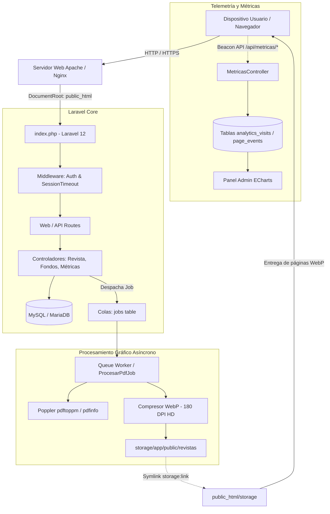

# 📖 ITINEWS v2.0 — Portal Digital y Visor Interactivo de Revistas Universitarias

> **Universidad Politécnica del Valle de Toluca (UPVT)**  
> *División de Ingeniería en Tecnologías de la Información*

[](https://php.net/)
[](https://laravel.com/)
[](https://tailwindcss.com/)
[](https://vitejs.dev/)
[](https://echarts.apache.org/)
[](LICENSE)

---

## 📌 Tabla de Contenidos
1. [Descripción del Proyecto](#-descripción-del-proyecto)
2. [Novedades de la Versión 2.0](#-novedades-de-la-versión-20)
3. [Stack Tecnológico](#-stack-tecnológico)
4. [Arquitectura del Sistema](#-arquitectura-del-sistema)
5. [Requisitos Previos](#-requisitos-previos)
6. [Guía de Instalación y Replicación](#-guía-de-instalación-y-replicación)
   - [Instalación en Windows (Laragon / Nativo)](#opción-a-windows-laragon--nativo)
   - [Instalación en Linux (Ubuntu / Debian / VPS)](#opción-b-linux-ubuntudebian--rhelalmalinux)
   - [Instalación en macOS](#opción-c-macos)
7. [Configuración de Entorno (.env)](#-configuración-de-entorno-env)
8. [Comandos de Mantenimiento y Operación](#-comandos-de-mantenimiento-y-operación)
9. [Límites del Sistema y Consideraciones Operativas](#-límites-del-sistema-y-consideraciones-operativas)
10. [Estructura del Repositorio](#-estructura-del-repositorio)
11. [Documentación Técnica Extendida](#-documentación-técnica-extendida)

---

## 🚀 Descripción del Proyecto

**ITINEWS** es una plataforma web integral diseñada para la difusión, lectura e interacción con revistas académicas, boletines y publicaciones periódicas de la UPVT.

El sistema digitaliza el material editorial en PDF, transformándolo mediante procesamiento gráfico automatizado en **experiencias de lectura interactiva tipo libro (*Flipbook*) en Ultra Alta Definición (WebP)**, complementado con analíticas respetuosas de la privacidad del lector, ambientación estacional del portal y un panel administrativo unificado.

---

## ✨ Novedades de la Versión 2.0

* **Pipeline Asíncrono Ultra HD (Poppler + WebP)**:
  - Extracción a alta resolución (180 DPI, ~2400px de altura) mediante binario nativo **Poppler** (`pdftoppm`).
  - Compresión moderna a formato **WebP** con ahorro del 70% de peso respecto a JPG sin perder fidelidad tipográfica.
  - Modal reactivo con barra de progreso porcentual paso a paso durante la carga.
* **Dashboard Administrativo de Métricas con Apache ECharts**:
  - Telemetría no invasiva con **Beacon API** y anonimización de lectores vía hash SHA-256.
  - Visualización interactiva: Treemap de páginas, gráficos de barras de popularidad, distribución de dispositivos (móvil vs escritorio) y tendencias temporales.
* **Sistema de Fondos Dinámicos y Estacionales**:
  - Gestión de ambientaciones del portal (Primavera, Verano, Otoño, Invierno, Día del Programador, Aniversario UPVT).
  - Programación por rango de fechas y carrusel automático con transiciones suaves *cross-fade*.
* **Visor Flipbook Avanzado**:
  - Renderizado a pantalla completa (`100vw × 100vh`) sin márgenes negros residuales.
  - Zoom HD interactivo en dos páginas simultáneas con arrastre (*pan & drag*).
  - Sección local privada *"Mis Estadísticas"* y biblioteca de favoritos.
* **Centro de Privacidad y Cumplimiento Normativo**:
  - Banner interactivo de cookies de 3 acciones (Permitir cookies, Solo necesarias, Preferencias).
  - Modal propio de preferencias con interruptor de almacenamiento funcional y modales informativos de Términos, Privacidad y Cookies.
* **Nuevo Panel de Administración y Login Split-Screen**:
  - Rejilla responsiva de tarjetas con botones de acción rápida perfectamente contenidos.
  - Interfaz de inicio de sesión dividida con ambientación artística y cierre por inactividad (`SessionTimeout`).

---

## 🛠 Stack Tecnológico

| Capa | Tecnologías |
|---|---|
| **Backend** | PHP 8.2 / 8.3, Laravel 12 (Jobs, Queues, Eloquent ORM, Blade) |
| **Frontend** | Vanilla JS ES6 modular, Tailwind CSS v4, Vite 7, StPageFlip, FontAwesome 6 |
| **Gráficas y Analíticas** | Apache ECharts 5, Beacon API, LocalStorage |
| **Gráficos y PDF** | Poppler Utils (`pdftoppm`, `pdfinfo`), PHP GD, Imagick (fallback) |
| **Base de Datos** | MySQL 8.0+ / MariaDB 10.5+ (Soporte SQLite para desarrollo/testing) |
| **Servidor Web** | Apache (`mod_rewrite`, DocumentRoot alineado a `public_html`) o Nginx |

---

## 🏛 Arquitectura del Sistema



---

## 📋 Requisitos Previos

1. **PHP**: versión **8.2** o **8.3**.
   - Extensiones: `pdo_mysql`, `gd`, `zip`, `fileinfo`, `mbstring`, `curl`, `xml`, `openssl`.
2. **Composer**: versión **2.x**.
3. **Node.js**: versión **18.x** o superior y **npm**.
4. **Motor Poppler** (Requerido para extracción ultrarrápida en Ultra HD):
   - Herramientas: `pdftoppm` y `pdfinfo`.
5. **Servidor de Base de Datos**: MySQL 8.0+, MariaDB 10.4+ o SQLite 3.

---

## 💻 Guía de Instalación y Replicación

### Opción A: Windows (Laragon / Nativo)

1. **Clonar el repositorio**:
   ```powershell
   cd C:\laragon\www
   git clone git@github-personal:HazaelH/itinews.git _itinews-upvt.com.mx
   cd _itinews-upvt.com.mx
   ```

2. **Instalar dependencias de PHP y JavaScript**:
   ```powershell
   composer install
   npm install
   ```

3. **Instalar Poppler en Windows**:
   - Vía Scoop:
     ```powershell
     scoop install poppler
     ```
   - O vía Chocolatey:
     ```powershell
     choco install poppler
     ```

4. **Configurar archivo de entorno**:
   ```powershell
   copy .env.example .env
   php artisan key:generate
   ```

5. **Configurar la base de datos en `.env` y migrar**:
   ```powershell
   php artisan migrate --seed
   ```

6. **Crear el enlace simbólico de almacenamiento**:
   ```powershell
   php artisan storage:link
   ```

7. **Compilar los assets del frontend**:
   ```powershell
   npm run build
   ```

---

### Opción B: Linux (Ubuntu/Debian & RHEL/AlmaLinux)

1. **Instalar dependencias del sistema y Poppler**:
   - En **Ubuntu / Debian**:
     ```bash
     sudo apt-get update
     sudo apt-get install -y php8.3-cli php8.3-fpm php8.3-mysql php8.3-gd php8.3-zip \
                             php8.3-mbstring php8.3-curl php8.3-xml poppler-utils git unzip
     ```
   - En **AlmaLinux / CentOS / RHEL**:
     ```bash
     sudo dnf install -y php php-mysqlnd php-gd php-zip php-mbstring poppler-utils git unzip
     ```

2. **Clonar e instalar dependencias**:
   ```bash
   git clone https://github.com/HazaelH/itinews.git /var/www/itinews
   cd /var/www/itinews
   composer install --no-dev --optimize-autoloader
   npm install && npm run build
   ```

3. **Configurar entorno y base de datos**:
   ```bash
   cp .env.example .env
   php artisan key:generate
   php artisan migrate --force --seed
   php artisan storage:link
   ```

4. **Configurar permisos de escritura**:
   ```bash
   sudo chown -R www-data:www-data storage bootstrap/cache public_html
   sudo chmod -R 775 storage bootstrap/cache
   ```

---

### Opción C: macOS

1. **Instalar dependencias con Homebrew**:
   ```bash
   brew install php composer node poppler
   ```

2. **Clonar y configurar**:
   ```bash
   git clone https://github.com/HazaelH/itinews.git itinews
   cd itinews
   composer install && npm install && npm run build
   cp .env.example .env
   php artisan key:generate
   php artisan migrate --seed
   php artisan storage:link
   ```

---

## ⚙ Configuración de Entorno (.env)

Variables esenciales a ajustar en `.env`:

```ini
APP_NAME=ITINEWS
APP_ENV=production
APP_DEBUG=false
APP_URL=https://tu-dominio.com.mx

# Base de Datos
DB_CONNECTION=mysql
DB_HOST=127.0.0.1
DB_PORT=3306
DB_DATABASE=itinews_db
DB_USERNAME=tu_usuario
DB_PASSWORD=tu_password

# Colas (Queues)
QUEUE_CONNECTION=database

# Rutas de Poppler (opcional si están en el PATH del sistema)
# POPPLER_PATH=/usr/bin/pdftoppm
# PDFINFO_PATH=/usr/bin/pdfinfo

# Retención de Métricas
ANALYTICS_ENABLED=true
ANALYTICS_RETENTION_MONTHS=12
```

---

## 🔧 Comandos de Mantenimiento y Operación

### 1. Procesamiento de Colas en Segundo Plano
Para que los PDFs se procesen en segundo plano sin congelar la interfaz web:
```bash
# En desarrollo:
php artisan queue:work

# En producción (tarea cron cada minuto):
* * * * * cd /ruta/al/proyecto && php artisan queue:work --stop-when-empty > /dev/null 2>&1
```

### 2. Reprocesamiento de Revistas a Ultra HD
Regenera páginas en formato WebP para todas las revistas existentes o una en específico:
```bash
# Todas las revistas activas:
php artisan revistas:reprocesar --all

# Revista específica por ID:
php artisan revistas:reprocesar 5
```

### 3. Depuración de Métricas Antiguas
Limpia visitas y registros anteriores al periodo de retención configurado:
```bash
php artisan analytics:purge
```

### 4. Caché de Producción
Acelera el tiempo de respuesta en servidores de producción:
```bash
php artisan config:cache
php artisan route:cache
php artisan view:cache
```

Para limpiar la caché durante el desarrollo:
```bash
php artisan optimize:clear
```

---

## ⚠️ Límites del Sistema y Consideraciones Operativas

1. **Tamaño Máximo de Subida en PHP**:
   - En `php.ini` es necesario configurar:
     ```ini
     upload_max_filesize = 120M
     post_max_size = 130M
     memory_limit = 512M
     max_execution_time = 300
     ```
2. **Capacidad de Almacenamiento**:
   - Cada página convertida a WebP en resolución Ultra HD (~2400px) pesa entre **300 KB y 600 KB**.
   - Una revista típica de 40 páginas ocupa entre **15 y 25 MB** de disco en `storage/app/public/`.
3. **Estructura `public_html`**:
   - La aplicación está deliberadamente preconfigurada para servir el DocumentRoot en `public_html/` (estándar de cPanel y servidores web seguros). Los archivos fuente de Laravel (`app`, `config`, `storage`) se mantienen seguros un nivel arriba del acceso web público.

---

## 📂 Estructura del Repositorio

```text
├── app/
│   ├── Console/Commands/        # Comandos personalizados (reprocesar revistas, purga métricas)
│   ├── Http/Controllers/        # Controladores (Revistas, Fondos, Métricas, Usuarios)
│   │   ├── Admin/               # Controladores del panel de administración
│   │   ├── Api/                 # Endpoints públicos de telemetría y visor
│   │   └── Auth/                # Controladores de autenticación y sesión
│   ├── Jobs/ProcesarPdfJob.php  # Motor de extracción Poppler y compresión WebP
│   └── Models/                  # Modelos Eloquent (Revista, Pagina, Fondo, Analytics)
├── bootstrap/app.php            # Configuración de Middlewares y DocumentRoot (public_html)
├── config/                      # Archivos de configuración de Laravel y métricas
├── database/migrations/         # Migraciones de esquemas de base de datos
├── public_html/                 # Directorio Raíz Público expuesto a la web
│   ├── build/                   # Assets compilados por Vite (CSS/JS en producción)
│   ├── css/                     # Estilos auxiliares, visor flipbook y panel admin
│   ├── js/                      # Lógica interactiva del visor, métricas y fondos
│   ├── storage/                 # Enlace simbólico a storage/app/public
│   └── index.php                # Front Controller de la aplicación
├── resources/
│   ├── css/                     # Fuentes Tailwind v4 y estilos maestros
│   ├── js/                      # Scripts maestros compilados por Vite
│   └── views/                   # Plantillas Blade (portal, visor, administración, legal)
├── routes/                      # Rutas web, API, consola y autenticación
├── storage/                     # Archivos de revistas, páginas WebP, logs y sesiones
├── DOCUMENTACION_TECNICA_V2.md  # Manual técnico exhaustivo y guía arquitectónica
└── vite.config.js               # Configuración de compilación con @tailwindcss/vite
```

---

## 📖 Documentación Técnica Extendida

Para un desglose minucioso de cada módulo, diagramas de secuencia de telemetría, análisis de escalabilidad futura y manual de mantenimiento detallado, consulte:
👉 [DOCUMENTACION_TECNICA_V2.md](file:///c:/laragon/www/_itinews-upvt.com.mx/DOCUMENTACION_TECNICA_V2.md)

---

## 👥 Créditos

Desarrollado para la **Universidad Politécnica del Valle de Toluca (UPVT)** por **Hazael Hernández Arriaga**.
