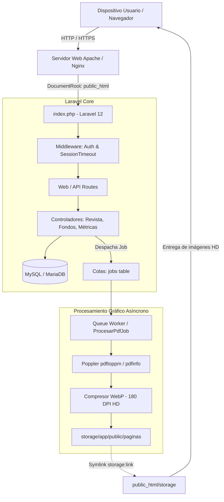
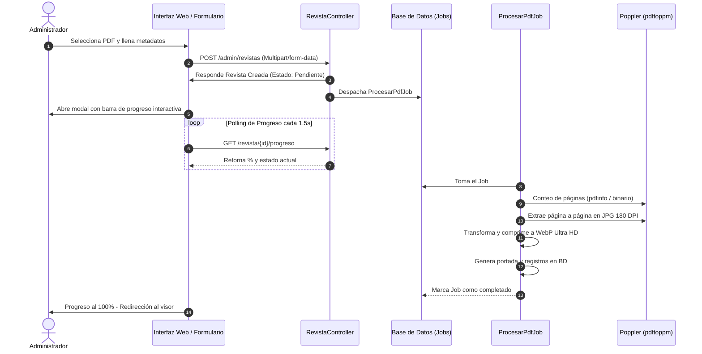

# 📖 ITINEWS — Portal Digital y Visor Interactivo de Revistas Universitarias

> **Universidad Politécnica del Valle de Toluca (UPVT)**  
> *Ingeniería en Tecnologías de la Información*

[](https://php.net/)
[](https://laravel.com/)
[](https://tailwindcss.com/)
[](https://vitejs.dev/)
[](LICENSE)

---

## 📌 Tabla de Contenidos
1. [Descripción del Proyecto](#-descripción-del-proyecto)
2. [Características Principales](#-características-principales)
3. [Stack Tecnológico](#-stack-tecnológico)
4. [Arquitectura del Sistema](#-arquitectura-del-sistema)
5. [Requisitos Previos](#-requisitos-previos)
6. [Guía de Instalación y Replicación](#-guía-de-instalación-y-replicación)
   - [Instalación en Windows (Laragon / Entorno Local)](#opción-a-windows-laragon--nativo)
   - [Instalación en Linux (Ubuntu / Debian / Servidores VPS)](#opción-b-linux-ubuntudebian--rhelalmalinux)
   - [Instalación en macOS](#opción-c-macos)
7. [Configuración de Entorno (.env)](#-configuración-de-entorno-env)
8. [Comandos de Mantenimiento y Operación](#-comandos-de-mantenimiento-y-operación)
9. [Límites del Sistema y Consideraciones Operativas](#-límites-del-sistema-y-consideraciones-operativas)
10. [Estructura del Repositorio](#-estructura-del-repositorio)

---

## 🚀 Descripción del Proyecto

**ITINEWS** es una plataforma web integral diseñada para la difusión, lectura e interacción con revistas académicas, boletines y publicaciones periódicas institucionales.

El sistema digitaliza el material editorial en PDF, transformándolo mediante procesamiento gráfico automatizado en **experiencias de lectura interactiva tipo libro (*Flipbook*) en Ultra Alta Definición (WebP)**, complementado con analíticas respetuosas de la privacidad del lector y un sistema dinámico de personalización estacional.

---

## ✨ Características Principales

* **Visor Flipbook Dual/Single Page**:
  - Efecto de hoja real con físicas fluidas (`PageFlip`).
  - Modo doble página en escritorio y página individual responsive en dispositivos móviles.
  - Visor a pantalla completa (`100vw x 100vh`) sin franjas residuales.
  - Zoom HD interactivo en dos páginas simultáneas con arrastre (pan & drag).
  - Cálculo de lectura en tiempo real con cierre exacto al 100%.
* **Pipeline Asíncrono de Procesamiento de PDFs**:
  - Extracción a alta resolución (180 DPI, ~2400px de ancho) con **Poppler** (`pdftoppm`).
  - Conversión optimizada a formato moderno **WebP** (85-92% de calidad con reducción de hasta 70% de peso).
  - Extracción y conteo ultrarrápido con **pdfinfo** o fallback nativo binario.
  - Modal reactivo con barra de progreso porcentual paso a paso durante la carga.
* **Sistema de Fondos Dinámicos y Fechas Conmemorativas**:
  - Personalización estacional del portal (Primavera, Verano, Otoño, Invierno).
  - Presets predefinidos para fechas clave de la disciplina (Día del Programador, Día Mundial del Internet, etc.).
  - Soporte de transiciones en carrusel cuando hay múltiples fondos concurrentes.
  - Guía integrada *"¿Cómo funciona?"* y modales nativos de validación de cambios.
* **Analíticas y Métricas de Lectura**:
  - Medición de visitas únicas, revistas más leídas, páginas más vistas y tiempo promedio de retención.
  - Anonimización por hash SHA-256 (sin recopilación de datos personales invasivos).
  - Dashboard con gráficas interactivas (`Chart.js`).
* **Seguridad y Control de Acceso**:
  - Roles administrativos y de edición (`admin`, `editor`).
  - Cierre automático de sesión por inactividad (`SessionTimeout`).
  - Protección CSRF, XSS y sanitización de archivos subidos.

---

## 🛠 Stack Tecnológico

| Capa | Tecnologías |
|---|---|
| **Backend** | PHP 8.2 / 8.3, Laravel 12 (Jobs, Queues, Eloquent ORM, Blade) |
| **Frontend** | Vanilla JS ES6 modular, Tailwind CSS v4, Vite 7, StPageFlip, FontAwesome |
| **Gráficos y PDF** | Poppler Utils (`pdftoppm`, `pdfinfo`), PHP GD, Imagick (fallback) |
| **Base de Datos** | MySQL 8.0+ / MariaDB 10.5+ (Soporte SQLite para entornos de prueba) |
| **Servidor Web** | Apache (`mod_rewrite`, DocumentRoot alineado a `public_html`) o Nginx |

---

## 🏛 Arquitectura del Sistema

### 1. Diagrama de Arquitectura Global



---

### 2. Flujo del Pipeline de Carga y Conversión de Revistas



---

## 📋 Requisitos Previos

1. **PHP**: versión **8.2** o superior (8.3 recomendada).
   - Extensiones requeridas: `pdo_mysql`, `gd`, `zip`, `fileinfo`, `mbstring`, `curl`, `xml`, `openssl`.
   - Extensión opcional: `imagick` (para redundancia de conversión).
2. **Composer**: versión **2.x**.
3. **Node.js**: versión **18.x** o superior y **npm**.
4. **Motor Poppler** (Requerido para conversión rápida en Ultra HD):
   - Herramientas: `pdftoppm` y `pdfinfo`.
5. **Servidor de Base de Datos**: MySQL 8.0+, MariaDB 10.4+ o SQLite 3.

---

## 💻 Guía de Instalación y Replicación

### Opción A: Windows (Laragon / Nativo)

1. **Clonar el repositorio**:
   ```bash
   cd C:\laragon\www
   git clone git@github-personal:HazaelH/itinews.git _itinews-upvt.com.mx
   cd _itinews-upvt.com.mx
   ```

2. **Instalar dependencias de PHP y JavaScript**:
   ```powershell
   composer install
   npm install
   ```

3. **Instalar Poppler en Windows**:
   - Vía Scoop (Recomendado):
     ```powershell
     scoop install poppler
     ```
   - O vía Chocolatey:
     ```powershell
     choco install poppler
     ```

4. **Configurar el archivo de entorno**:
   ```powershell
   copy .env.example .env
   php artisan key:generate
   ```

5. **Configurar la base de datos en `.env` y migrar**:
   ```powershell
   php artisan migrate --seed
   ```

6. **Crear el enlace de almacenamiento**:
   ```powershell
   php artisan storage:link
   ```

7. **Compilar los assets del frontend**:
   ```powershell
   npm run build
   ```

---

### Opción B: Linux (Ubuntu/Debian & RHEL/AlmaLinux)

1. **Instalar dependencias del sistema y Poppler**:
   - En **Ubuntu / Debian**:
     ```bash
     sudo apt-get update
     sudo apt-get install -y php8.3-cli php8.3-fpm php8.3-mysql php8.3-gd php8.3-zip \
                             php8.3-mbstring php8.3-curl php8.3-xml poppler-utils git unzip
     ```
   - En **AlmaLinux / CentOS / RHEL**:
     ```bash
     sudo dnf install -y php php-mysqlnd php-gd php-zip php-mbstring poppler-utils git unzip
     ```

2. **Clonar e instalar dependencias**:
   ```bash
   git clone https://github.com/HazaelH/itinews.git /var/www/itinews
   cd /var/www/itinews
   composer install --no-dev --optimize-autoloader
   npm install && npm run build
   ```

3. **Configurar entorno y base de datos**:
   ```bash
   cp .env.example .env
   php artisan key:generate
   # Editar .env con tus credenciales de BD: nano .env
   php artisan migrate --force
   php artisan storage:link
   ```

4. **Configurar permisos de escritura**:
   ```bash
   sudo chown -R www-data:www-data storage bootstrap/cache public_html
   sudo chmod -R 775 storage bootstrap/cache
   ```

---

### Opción C: macOS

1. **Instalar dependencias con Homebrew**:
   ```bash
   brew install php composer node poppler
   ```

2. **Clonar y configurar**:
   ```bash
   git clone https://github.com/HazaelH/itinews.git itinews
   cd itinews
   composer install
   npm install
   npm run build
   cp .env.example .env
   php artisan key:generate
   php artisan migrate
   php artisan storage:link
   ```

---

## ⚙ Configuración de Entorno (.env)

Variables esenciales a ajustar en `.env`:

```ini
APP_NAME=ITINEWS
APP_ENV=production
APP_DEBUG=false
APP_URL=https://tu-dominio.com.mx

# Base de Datos
DB_CONNECTION=mysql
DB_HOST=127.0.0.1
DB_PORT=3306
DB_DATABASE=itinews_db
DB_USERNAME=tu_usuario
DB_PASSWORD=tu_password

# Colas (Queues)
QUEUE_CONNECTION=database

# Rutas de Poppler (opcional si están en el PATH del sistema)
# POPPLER_PATH=/usr/bin/pdftoppm
# PDFINFO_PATH=/usr/bin/pdfinfo

# Retención de Métricas
ANALYTICS_ENABLED=true
ANALYTICS_RETENTION_MONTHS=12
```

---

## 🔧 Comandos de Mantenimiento y Operación

### 1. Procesamiento de Colas en Segundo Plano
Para que los PDFs se procesen sin congelar la interfaz web:
```bash
# En desarrollo:
php artisan queue:work

# En servidores con cron (cada minuto):
* * * * * cd /ruta/al/proyecto && php artisan queue:work --stop-when-empty > /dev/null 2>&1
```

### 2. Reprocesamiento de Revistas a Ultra HD
Si se agregaron revistas previamente con menor calidad o se migró de servidor, se pueden regenerar todas automáticamente:
```bash
# Reprocesar todas las revistas activas:
php artisan revistas:reprocesar --all

# Reprocesar una revista en particular por ID:
php artisan revistas:reprocesar 5
```

### 3. Depuración de Métricas Antiguas
Limpia visitas y registros anteriores al periodo de retención configurado:
```bash
php artisan analytics:purge
```

### 4. Caché de Producción
Acelera el tiempo de respuesta en servidores de producción:
```bash
php artisan config:cache
php artisan route:cache
php artisan view:cache
```

Para revertir la caché en desarrollo:
```bash
php artisan optimize:clear
```

---

## ⚠️ Límites del Sistema y Consideraciones Operativas

1. **Tamaño Máximo de Subida en PHP**:
   - Por defecto, PHP limita las subidas a 2MB. En `php.ini` es mandatorio configurar:
     ```ini
     upload_max_filesize = 120M
     post_max_size = 130M
     memory_limit = 512M
     max_execution_time = 300
     ```
2. **Capacidad de Almacenamiento en Disco**:
   - Cada página convertida a WebP en resolución Ultra HD (~2400px) pesa entre **300 KB y 650 KB**.
   - Una revista típica de 40 páginas ocupa entre **15 y 25 MB** de disco en `storage/app/public/paginas/`.
3. **Consumo de Memoria y CPU durante la Conversión**:
   - El renderizado de páginas PDF complejas o con gráficos vectoriales pesados a 180 DPI hace un uso intensivo de CPU momentáneo. Se recomienda al menos 1 GB de RAM libre en el servidor durante la ejecución del job.
4. **Hosting Compartido vs Servidor VPS**:
   - En hostings compartidos que no permitan procesos daemon (Supervisor), configure `QUEUE_CONNECTION=sync` para procesar en la misma petición o cree una tarea programada (cron) que ejecute `php artisan queue:work --stop-when-empty`.
5. **Estructura `public_html`**:
   - La aplicación está deliberadamente preconfigurada para servir el DocumentRoot en `public_html/` (estándar de cPanel y servidores web seguros). Los archivos fuente de Laravel (`app`, `config`, `storage`) se mantienen seguros un nivel arriba del acceso web público.

---

## 📂 Estructura del Repositorio

```text
├── app/
│   ├── Console/Commands/        # Comandos personalizados (reprocesar revistas, purga métricas)
│   ├── Http/Controllers/        # Controladores (Revistas, Fondos, Métricas, Usuarios)
│   ├── Jobs/ProcesarPdfJob.php  # Motor de extracción Poppler/Imagick y compresión WebP
│   └── Models/                  # Modelos Eloquent (Revista, Pagina, Fondo, Analytics)
├── bootstrap/app.php            # Configuración de Middlewares y DocumentRoot (public_html)
├── config/                      # Archivos de configuración de Laravel y métricas
├── database/migrations/         # Migraciones de esquemas de base de datos
├── public_html/                 # Directorio Raíz Público expuesto a la web
│   ├── build/                   # Assets compilados por Vite (CSS/JS en producción)
│   ├── css/                     # Estilos auxiliares y visor flipbook
│   ├── js/                      # Lógica interactiva del visor y dashboard
│   ├── storage/                 # Enlace simbólico a storage/app/public
│   └── index.php                # Front Controller de la aplicación
├── resources/
│   ├── css/                     # Fuentes Tailwind v4 y estilos maestros
│   ├── js/                      # Scripts maestros compilados por Vite
│   └── views/                   # Plantillas Blade (portal, visor, administración)
├── routes/                      # Rutas web, API, consola y autenticación
├── storage/                     # Archivos de revistas, páginas WebP, logs y sesiones
├── vite.config.js               # Configuración de compilación con @tailwindcss/vite
└── composer.json / package.json # Dependencias de backend y frontend
```

---

## 👥 Contribución y Créditos

Desarrollado para la **Universidad Politécnica del Valle de Toluca (UPVT)** por **Hazael Hernández Arriaga en el periodo Septiembre - Diciembre del 2025**.

Cualquier consulta o reporte de incidencias puede gestionarse a través del gestor de issues del repositorio.
